# Launcher · Orbit UI

A fork of [bmorcelli/Launcher](https://github.com/bmorcelli/Launcher) with a from-scratch,
pixel-art interface for the **M5Stack Cardputer** and **Cardputer ADV**, drawn for their
240×135 screen. Underneath it is the same Launcher: install firmware from SD, online or a web
UI, manage partitions, and boot whichever app you like.

This fork builds and releases for the Cardputer only. For every other board, use
[upstream Launcher](https://github.com/bmorcelli/Launcher).

> **Status:** compiled, linked and checked screen by screen in a desktop build, but not yet
> run on a real Cardputer. Treat it as a beta and keep a copy of your current firmware.

<p align="center">
  
</p>

Every image here was rendered by the firmware's own drawing code (`src/orbit`) in a
desktop build, at 2× size. Nothing is a mockup.

### Boot and home

<p align="center">
  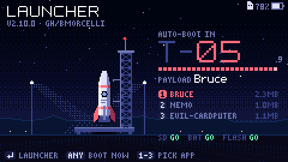
  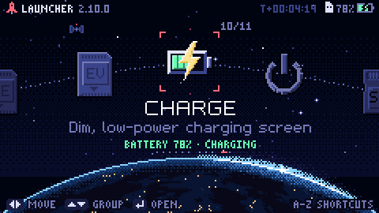
</p>

The launch pad counts down to the app that boots next. **Enter** opens the Launcher, **1–9**
boots that installed app straight away, and any other key boots now (or asks which app, if you
have several). Home is a planet you orbit:
SD card, Online, Web UI, USB drive, Partitions and Settings, then your installed apps, then
**Charge** and **Power off** (Charge mode lives here now, not in Settings).

### Installing

<p align="center">
  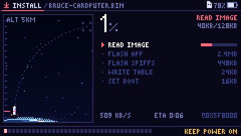
  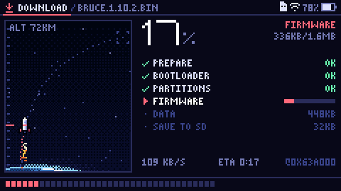
</p>

Installs from SD, online and the web UI all get the same flight screen: a trajectory, the
percentage, a checklist of stages (flash app, SPIFFS, partition table, boot slot, restore
data), speed, ETA and the flash address being written.

### SD card

<p align="center">
  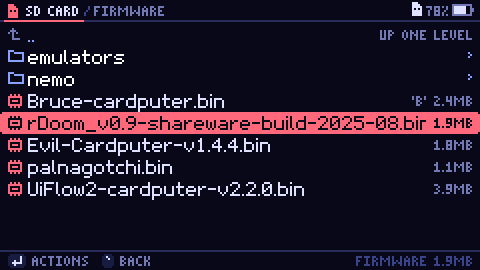
  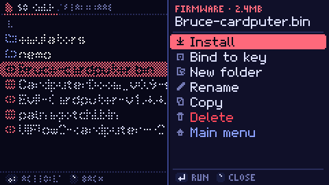
</p>
<p align="center">
  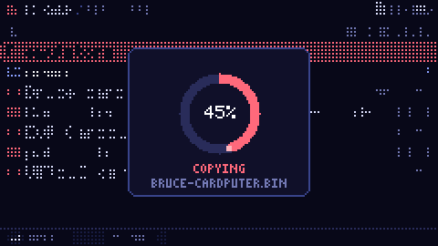
  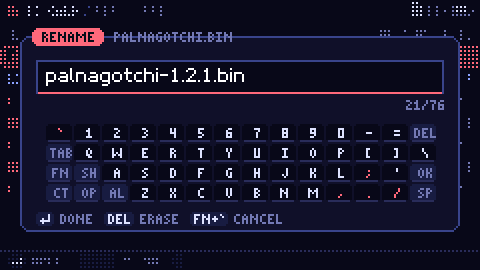
</p>

### Online

<p align="center">
  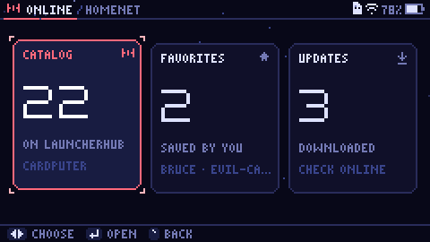
  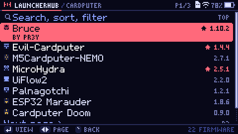
</p>
<p align="center">
  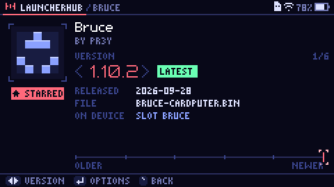
  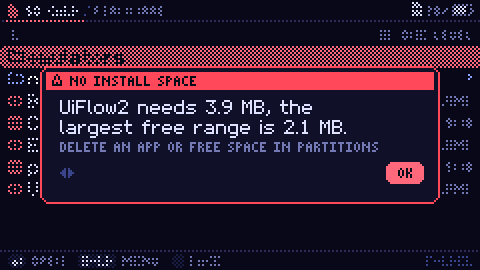
</p>

### Wi-Fi

<p align="center">
  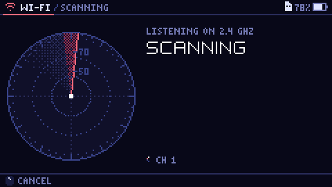
  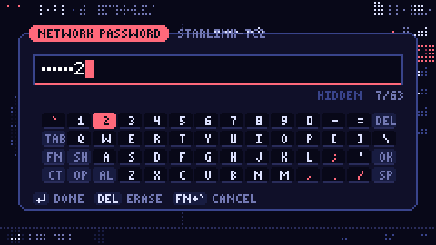
</p>

### Web UI and USB drive

<p align="center">
  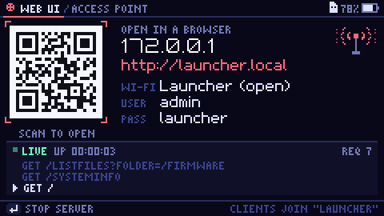
  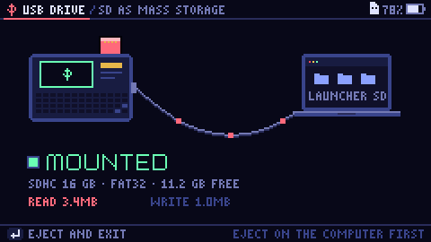
</p>

The QR code is real: scan it to open the web UI.

### Partitions and apps

<p align="center">
  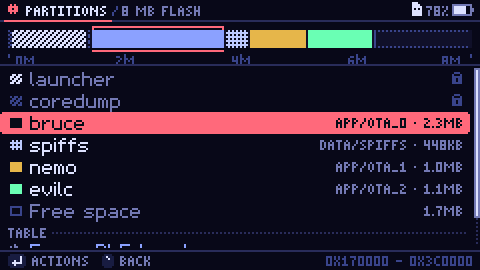
  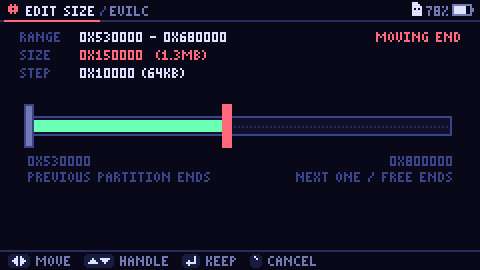
</p>
<p align="center">
  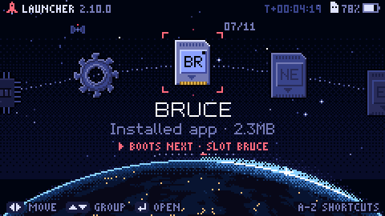
  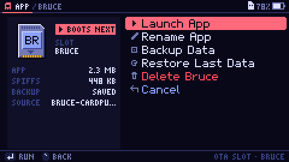
</p>

### Settings, themes and charging

<p align="center">
  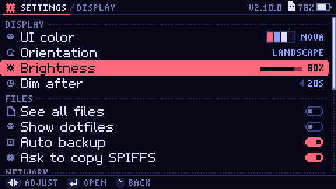
  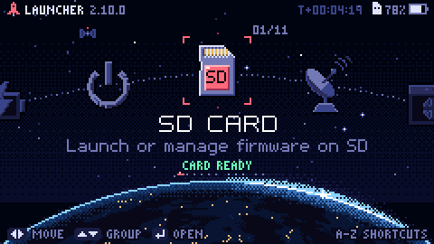
</p>
<p align="center">
  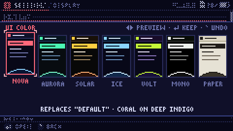
  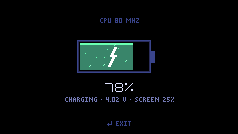
</p>

Seven themes: Nova, Aurora, Solar, Ice, Volt, Mono and Paper. Your old UI colour maps to the
closest one the first time you boot.

### Controls

| Key | Does |
|---|---|
| `,` `/` | left / right (move along the orbit, change a value) |
| `;` `.` | up / down (lists, tile groups on the home screen) |
| Enter | open, select; hold it in the SD browser for the folder menu |
| `` ` `` or Backspace | back |
| Fn + `` ` `` | cancel text entry |
| a–z on home | run a file bound to that key (SD › Bind to key) |
| 1–9, 0 on the boot screen | boot that installed app |

### Flashing

Download `Launcher-m5stack-cardputer.bin` from the
[Releases](https://github.com/BenjaminAddison/launcher_orbit/releases) page (the `beta`
release is rebuilt from every push to `main`). One file works on both the Cardputer and the
Cardputer ADV: the ADV keyboard is detected at boot.

It is a merged image, so flash it at address `0x0`. Hold **G0** while plugging in the USB
cable to enter download mode, then:

```bash
esptool.py --chip esp32s3 write_flash 0x0 Launcher-m5stack-cardputer.bin
```

You can also use [web.esphome.io](https://web.esphome.io/). M5Burner and the upstream Launcher
Flasher install upstream Launcher, not this fork.

### Building

The Orbit UI is turned on for the Cardputer only (`-D ORBIT_UI=1` in
`boards/m5stack-cardputer/platformio.ini`); every other env still builds the original UI.

```bash
git clone --recursive https://github.com/BenjaminAddison/launcher_orbit
```

```bash
cd launcher_orbit && pio run -e m5stack-cardputer
```

The build writes `Launcher-m5stack-cardputer.bin` to the project root. The new UI adds about
28 KB to the firmware, and the build still has about 5.7 KB free in the 1.31 MB app partition.
Developer notes are in [`src/orbit/README.md`](src/orbit/README.md).

### Release notes

**Orbit UI, first release** (based on Launcher 2.10.0)

* New pixel-art interface for the Cardputer and Cardputer ADV (`src/orbit`), behind
  `ORBIT_UI`; other boards build exactly as before.
* Home is a planet you orbit: SD, Online, Web UI, USB drive, Partitions, Settings, your
  installed apps, then Charge and Power off. Charge mode moved here from Settings.
* Launch-pad boot screen with a countdown, 1–9 shortcuts and an app picker.
* One install screen for SD, online and web UI installs: stage checklist, speed, ETA and
  flash address.
* Redrawn SD browser, Wi-Fi radar, LauncherHub catalog and firmware pages, Web UI with a
  scannable QR code, USB drive, partition map, settings, on-screen keyboard and dialogs.
* Seven colour themes (Nova, Aurora, Solar, Ice, Volt, Mono, Paper); your old UI colour maps
  to the closest one.
* CI builds and releases only the `m5stack-cardputer` binary.

### What's different from upstream

* The Cardputer build uses the Orbit UI; the rest of the source tree is upstream Launcher.
* Charge mode is on the home screen instead of in Settings.
* Releases contain the Cardputer binary only, and are not published to M5Burner.

---

# About Launcher

[Launcher](https://github.com/bmorcelli/Launcher) by [@bmorcelli](https://github.com/bmorcelli)
is an application launcher for M5Stack, LilyGO, Seeed Studio, Waveshare, CYD, Marauder and
many other ESP32 devices. It keeps itself in the first app slot and installs other firmware
next to it, so you can switch between them without a computer. Join its
[Discord community](https://discord.gg/BE9by2a2FF).

With Launcher you can:

* **Install firmware** from the SD card, from online catalogs (LauncherHub, M5Burner, GitHub
  links), or from a browser through its web UI.
* **Manage the SD card**: create folders, rename, copy, paste and delete files.
* **Use the web UI** to manage files, edit text files and NVS data, and install firmware
  wirelessly.
* **Manage partitions**: view, create, delete, resize, format, back up and restore SPIFFS and
  FAT partitions, and switch partition schemes for large apps or UiFlow2.
* **Configure** brightness, dim time, rotation, UI colour, SPIFFS handling and file filters.

After an install, the device boots the installed app unless you press a key on the boot
screen.

## My SD card doesn't work!

* Use an SDHC card (not SDXC), 32 GB or smaller (8 or 16 GB is ideal).
* Format it as FAT32 with an MBR partition scheme, not GPT ([Rufus](https://rufus.ie/) works).
* exFAT and larger cards have been supported since 2.8.0, but smaller FAT32 cards are more
  reliable.

## Known issues

* UiFlow 1 doesn't work with Launcher: it uses an old MicroPython and ESP-IDF that Launcher
  can't boot.

## More

* Supported boards, full changelog and releases:
  [bmorcelli/Launcher](https://github.com/bmorcelli/Launcher)
* How it works: [Launcher Wiki](https://github.com/bmorcelli/Launcher/wiki/Explaining-the-project)
* Finding firmware to install:
  [Obtaining binaries to launch](https://github.com/bmorcelli/Launcher/wiki/Obtaining-binaries-to-launch)
  and the [catalog](https://bmorcelli.github.io/Launcher/catalog.html)
